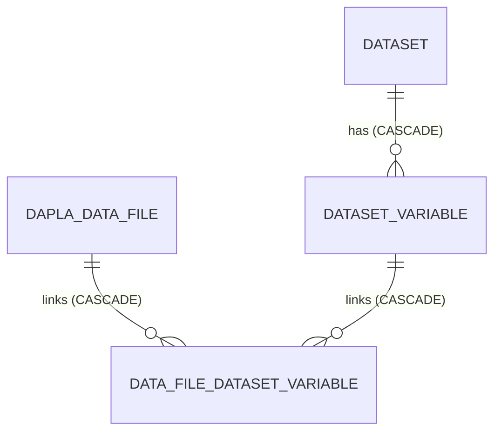

# ADR0004 - Dataset variables are removed by database cascade

* Status: accepted
* Authority: @statisticsnorway/dapla-metadata-developers
* Date: 2026-10-21

## Context and problem statement

Entities in datadoc-service aren't created or deleted by users. They are derived from the physical data files on the
data platform. A `Dataset` is removed by `DatasetLifecycleService` only once its last data file is gone, either through
`deleteById` or when a task completes and unreported files are deleted.

DatasetVariables belong to a dataset and are shared by all of its data files that contain them, so the same variable isn't stored once per data file. 
A `DatasetVariable` is linked to those `DaplaDataFile`s through the join table `data_file_dataset_variable`.

* A dataset owns its variables. A DatasetVariable don't exist without the dataset.
* A DatasetVariable can appear in many data files, and a data file contains many DatasetVariables (many-to-many, through
  `data_file_dataset_variable`).
* A link row depends on both ends. The DatasetVariable and the data file don't depend on each other.

The baseline schema (V1) declares its foreign keys without `ON DELETE`, so the application deletes rows in dependency
order. DatasetVariables add three new foreign keys. We must decide whether the application or the database removes the
dependent rows when a dataset or data file is deleted.

## Decision drivers

* A DatasetVariable has no meaning without its dataset, and a link row has no meaning without both of its ends.
* Task completion can delete many data files in one operation. Per-row cleanup in the application adds queries and
  creates a window where orphaned rows are visible.
* DatasetVariables must never block deletion: a data file that has disappeared from the source has to go.
* Under ADR0003 the constraint is explicit in the migration and reviewable.

## Considered options

* `ON DELETE CASCADE` on all three new foreign keys
* No cascade, with the application deleting links and DatasetVariables explicitly
* Soft delete of DatasetVariables

## Decision

Chosen option: "`ON DELETE CASCADE` on all three new foreign keys", because every row concerned is wholly owned by its
parent and has no independent lifecycle.

| Foreign key                                     | Behaviour                                                               |
|-------------------------------------------------|-------------------------------------------------------------------------|
| `dataset_variable.dataset_id → dataset`         | Deleting a dataset deletes its DatasetVariables.                               |
| `data_file_dataset_variable.data_file_id`       | Deleting a data file removes its links. The DatasetVariables themselves stay.  |
| `data_file_dataset_variable.dataset_variable_id`| Deleting a DatasetVariable removes its links. The data files themselves stay.  |

The link rows are removed from both sides, so deleting a file never deletes a DatasetVariable that other files in the same
dataset still use. DatasetVariables are removed only together with their dataset.

Any cascade does not remove a DatasetVariable which no data file is linked to anymore. See
[ADR0005](0005-dataset-variables-are-identified-by-short-name.md) for how that is handled.

The existing baseline foreign keys are left unchanged. Changing them would be unrelated to this feature.

### Positive consequences

* The database guarantees two things, whichever code path deletes:
  * A link between a data file and a DatasetVariable is removed when either of them is deleted, so no link points at
    something that no longer exists.
  * A DatasetVariable is removed when its dataset is deleted, so no DatasetVariable belongs to a dataset that no longer exists.
* Deleting a dataset or a data file needs no DatasetVariable-specific cleanup of links, and new deletion paths cannot forget
  it.
* Deleting many files at task completion stays a small number of statements.

### Negative consequences

* Deleting a dataset removes its DatasetVariable metadata with no application-level hook, so any future need to audit, log or
  veto that removal must be done in the database or by changing this decision.
* DatasetVariables that lose their last link are not covered by the cascade and need separate handling (ADR0005).
* The cascade is inconsistent with the baseline foreign keys, which still require ordered deletes in the application.
* Hibernate is not told about rows the database deletes by cascade. DatasetVariables loaded earlier in the same transaction
  as the delete of their dataset still appear to exist, so code that does both should reload them or clear the session.
  The current deletion paths do not read DatasetVariables, so this is a caution for future code.

## Pros and cons of the options not chosen

### No cascade, application deletes it explicitly

* Positive, because it matches the baseline and keeps all deletion logic in one language.
* Negative, because every delete path must remember the extra steps, and a missed one fails at runtime with a foreign
  key violation, or in the worst case blocks removal of a vanished file.

### Soft delete of variables

* Positive, because variable history would be retained.
* Negative, because nothing requires history, and it would add a flag that every query must filter on.

## Links

* Related to [ADR0003 — Adopt Flyway for schema migrations](0003-adopt-flyway-for-schema-migrations.md): the cascade is
  declared in a Flyway migration
* Migration: `src/main/resources/db/migration/V3__add_dataset_variable.sql`
* Entities: `src/main/kotlin/no/ssb/metadata/datadoc/models/DatasetVariable.kt`, `DaplaDataFile.kt`
* Deletion paths: `src/main/kotlin/no/ssb/metadata/datadoc/services/DatasetLifecycleService.kt`

<!-- markdownlint-disable-file MD013 -->

---

*Copied from [statisticsnorway/datadoc-service@ab0fc6d](https://github.com/statisticsnorway/datadoc-service/blob/ab0fc6d/docs/adr/0004-cascade-deletes-for-dataset-variables.md) on 2026-10-30 by `make collect-adrs`. The canonical version is maintained in that repository.*
